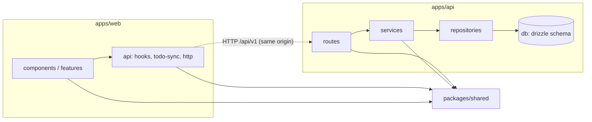
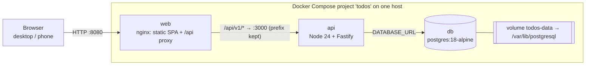
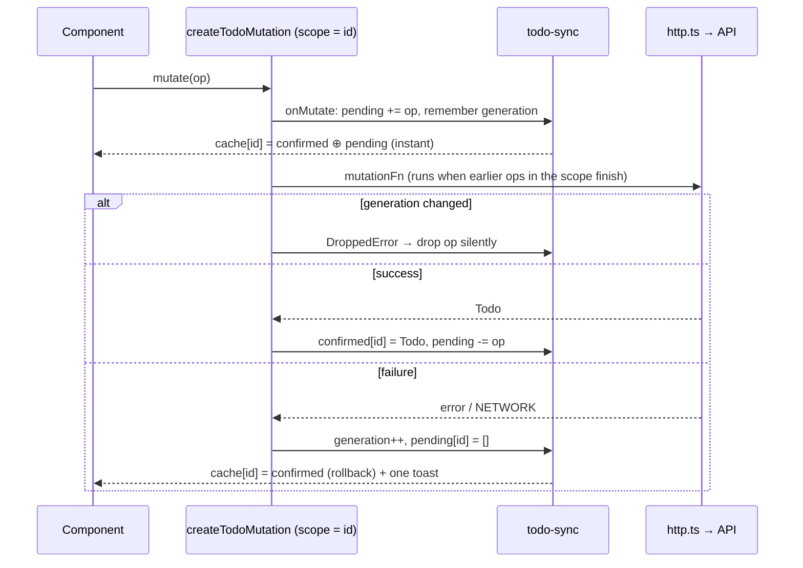

# Architecture Spine — Todos

## Design Paradigm

**Layered client–server with a shared contract.** A single-page React app (`apps/web`) calls a REST API (`apps/api`), which is layered as routes → service → repository → PostgreSQL. The only thing either app shares with the other is `packages/shared`: the Zod schemas for the Todo DTO, request bodies, and error envelope.

| Layer | Location | Owns |
| --- | --- | --- |
| Contract | `packages/shared` | Zod schemas and their inferred types, error codes, API path constants, limits, `compareTodos` |
| UI | `apps/web/src/components`, `apps/web/src/features/todos` | Rendering and UX behavior from EXPERIENCE.md. Never calls `fetch` or writes to the cache |
| Client data | `apps/web/src/api` | `http.ts` (the only `fetch` caller), `query-client.ts`, `todo-sync.ts`, query and mutation hooks |
| Transport | `apps/api/src/routes`, `apps/api/src/errors.ts` | HTTP ↔ contract mapping, validation, status codes, the one error handler |
| Domain | `apps/api/src/services` | Todo rules: normalizing text, idempotent create, last-write-wins |
| Persistence | `apps/api/src/repositories`, `apps/api/src/db` | Drizzle schema, queries, migrations |

## Invariants & Rules



Arrows are the only allowed import directions. `apps/web` and `apps/api` never import each other. `packages/shared` imports nothing except `zod`, and is consumed as TypeScript source through the pnpm workspace (`"@todos/shared": "workspace:*"`).

### AD-1 — Shared contract package is the single source of truth

- **Binds:** FR-5, FR-11, NFR-6, all API and client data code
- **Prevents:** the frontend and API drifting apart on field names, types, limits, ordering, or error codes.
- **Rule:** Every request body, response body, and error shape is a Zod schema exported from `packages/shared`. Request schemas are `.strict()`, so unknown keys are rejected. The API validates requests and serializes responses through `@fastify/type-provider-zod` using those schemas. The web client parses every response with the same schema before it touches the cache. Hand-written copies of these types are forbidden. The constants `DESCRIPTION_MAX = 500`, `COUNTER_THRESHOLD = 450`, `REQUEST_TIMEOUT_MS = 10_000`, and the list comparator `compareTodos` (`createdAt` descending, then `id` descending) exist only in `packages/shared`.

### AD-2 — REST resource surface, versioned and additive-only

- **Binds:** FR-1, FR-4, FR-6, FR-7, FR-8, FR-11, NFR-8
- **Prevents:** competing endpoint shapes, incompatible PATCH semantics, and breaking changes when owners or new fields arrive later.
- **Rule:** The API registers its routes with the full `/api/v1` prefix. No proxy ever strips the prefix (AD-9). The endpoints are exactly these:

  | Method | Path | Body | Success |
  | --- | --- | --- | --- |
  | GET | `/api/v1/todos` | — | `200` `{ "todos": Todo[] }`, ordered by `compareTodos` |
  | POST | `/api/v1/todos` | `{ id, description }` | `201` `Todo`, or `200` on an idempotent replay (AD-4) |
  | PATCH | `/api/v1/todos/:id` | `{ description?, completed? }`, at least one key | `200` `Todo` |
  | DELETE | `/api/v1/todos/:id` | — | `204`, no body |
  | GET | `/api/v1/health` | — | `200` `{ "status": "ok" }` only when a `SELECT 1` against the DB succeeds; otherwise `503` with the AD-5 envelope |
  | GET | `/api/v1/openapi.json` | — | `200` the OpenAPI 3.0 document generated from the shared schemas (Story 3.2); not listed in the document itself |

  PATCH sends only the fields the user changed. A missing key means "unchanged", and `null` is a validation error. Changes within v1 are additive only: new response fields and new optional request fields are allowed, but renaming, removing, or retyping a field is not. Clients ignore unknown response fields. The list is always wrapped in an object, never returned as a bare array.

  Besides the statuses above and the AD-5 errors for its own inputs, every route can return a framework `400` (for example a malformed URL), and every route with a body parser (POST, PATCH and DELETE) can return `413` and `415`. The client sends DELETE with no body, but a DELETE that carries one has it parsed. The OpenAPI document lists every status each route can actually return (Story 3.2, amended 2026-09-25).

### AD-3 — Todo DTO, normalization, and server-owned time

- **Binds:** FR-1, FR-4, FR-5, FR-6, FR-7, NFR-3, NFR-10
- **Prevents:** disagreement on field names, date precision, how length is measured, line breaks, and who owns the clock.
- **Rule:**
  - **Shape:** `Todo = { id, description, completed, createdAt, updatedAt }`. `id` is any RFC 9562 UUID string (`z.uuid()`, version not enforced). The timestamps are ISO-8601 UTC strings with exactly millisecond precision.
  - **Time:** the database clock is the only clock. The columns are `timestamptz(3)`. `created_at` defaults to `now()`, and every UPDATE that changes a value sets `updated_at = GREATEST(now(), updated_at)`. `now()` is the transaction start, so a racing PATCH that commits last never moves `updated_at` backwards. The repository maps `Date` to an ISO string. Client-supplied timestamps are rejected by the strict schemas.
  - **Normalization, done by the service, the same way for POST and PATCH:** replace each `\r\n`, `\r`, or `\n` with a space, then trim. The result must be 1 to `DESCRIPTION_MAX` long, measured as JavaScript `string.length` (UTF-16 code units, the same unit as the HTML `maxlength` attribute).
  - **Concurrent writes:** last write wins. A PATCH that changes nothing returns the stored Todo unchanged.

### AD-4 — Client-generated identity and idempotent writes

- **Binds:** FR-4, FR-8, FR-10, NFR-3
- **Prevents:** optimistic Todos that can't be referenced before the server replies, duplicates created by retries or races, and deletes that fail because a response was lost.
- **Rule:**
  - **Ids:** the web client generates each Todo `id` as a UUIDv7 using the `uuid` package, never `crypto.randomUUID`, which is unavailable over plain-HTTP network access. A "Retry" of a failed create resends the **original** `id` and Description. A "Retry" of a failed edit resends the original PATCH.
  - **POST:** the service runs `INSERT … ON CONFLICT (id) DO NOTHING`. If a row with that `id` already exists, the response is `200` with the stored Todo when the normalized Description matches, and `409 CONFLICT` otherwise.
  - **Late create retries:** the comparison is against the *stored* Description. A create Retry for a Todo since edited elsewhere gets `409`, and the client shows the add failure. A create Retry for a Todo since deleted re-creates it, because Retry means "make this Todo exist". Both are accepted multi-tab edge cases (decision 2026-09-25, sprint-change-proposal-2026-09-25).
  - **DELETE:** an unknown `id` returns `404`. The client treats `404` on DELETE as success.
  - **PATCH:** an unknown `id` returns `404`. The client treats this as the Todo having been deleted elsewhere: its confirmed state becomes `null`, the Todo is removed, and the failure toast for that action is shown. A pending edit's typed text goes into that toast's quoted text, following EXPERIENCE.md's "Edit failed, another Todo is being edited" copy.

### AD-5 — Error envelope, code set, and edge-error mapping

- **Binds:** FR-5, FR-10, FR-11, NFR-9
- **Prevents:** Fastify defaults, route code, and nginx each producing different error bodies, and raw server text reaching the UI.
- **Rule:** Every non-2xx response the API sends has this body:

  ```text
  { "error": { "code": ErrorCode, "message": string, "details"?: [{ "field": string, "reason": "empty" | "too_long" | "invalid" | "unknown_field" }] } }
  ```

  `ErrorCode` is a closed enum in `packages/shared`.

  | Code | Status | Raised for |
  | --- | --- | --- |
  | `VALIDATION_ERROR` | 400 | Zod validation failures (with `details`), malformed JSON, a JSON content type with an empty body, and errors raised before routing, such as a malformed URL, on any route (Fastify `frameworkErrors`) |
  | `VALIDATION_ERROR` | 413 | Body over `bodyLimit` (16 KiB), on any route that parses a body, DELETE included |
  | `VALIDATION_ERROR` | 415 | Unsupported content type, on any route that parses a body, DELETE included |
  | `NOT_FOUND` | 404 | Unknown Todo id or unknown route (`setNotFoundHandler`) |
  | `CONFLICT` | 409 | Idempotent-replay mismatch (AD-4) |
  | `UNAVAILABLE` | 503 | Health check failed, or the database is unreachable |
  | `INTERNAL` | 500 | Anything else. No stack trace in the body |

  One `setErrorHandler` in `apps/api/src/errors.ts` produces every error, and the not-found handler and the `frameworkErrors` hook send the same envelope. Routes and services throw `AppError(code, details?)` and never write error bodies themselves. An API test covers each row of the table. The OpenAPI document lists, per route, every status in this table that the route can actually return.

  **Client side:**
  - The web shows the "too long" copy when `details` contains `reason: "too_long"`. For every other code, it shows the failure copy for that action (EXPERIENCE.md), and it **never renders `message`**.
  - A response whose body isn't this envelope is classified as `INTERNAL`. The `web` container's nginx sends such responses itself: HTML `502` or `504` when the API is unreachable, and HTML `413` for a body over its `client_max_body_size 32k`. That limit is twice `bodyLimit`, so a body just over 16 KiB still reaches the API and gets the JSON `413`. The OpenAPI description says so.
  - A `fetch` rejection or timeout is classified as the client-only kind `NETWORK`.

### AD-6 — Client server-state: one cache, pinned query defaults, one HTTP caller

- **Binds:** FR-1, FR-3, FR-10, NFR-1, NFR-3
- **Prevents:** duplicate client stores of Todos, background refetches overwriting optimistic rows, silently paused requests, and inconsistent HTTP handling.
- **Rule:**
  - **The cache:** the rendered Todo List exists only in the TanStack Query cache under `['todos']`. The only other Todo data the client keeps is the per-Todo sync bookkeeping in `todo-sync.ts` (AD-12). Components hold only UI state, such as input drafts and edit-mode text, plus display-only copies of deleted rows that `TodoList` keeps only for their exit motion. These copies are never sync state and are never written to the cache.
  - **Pinned defaults:** `query-client.ts` sets these defaults for queries and mutations, and hooks must not override them:
    - `staleTime: Infinity`
    - `gcTime: Infinity`
    - `retry: false`
    - `networkMode: 'always'`
    - `refetchOnWindowFocus: false`, `refetchOnReconnect: false`, `refetchOnMount: false`
  - **Fetching the list:** the list is fetched only when the page loads and by "Try again", which calls `resetQueries({ queryKey: ['todos'] })`. A successful list fetch seeds the confirmed store in `todo-sync.ts`, and the rendered list is the seeded state with pending ops re-applied. Seeding never sets an id with pending ops to `null`.
  - **Writes:** mutations never call `invalidateQueries(['todos'])`.
  - **The HTTP client:** `http.ts` is the only code that calls `fetch`. It always requests the relative path `/api/v1/...` and uses `AbortSignal.timeout(REQUEST_TIMEOUT_MS)`. It sets `Content-Type: application/json` only when there is a body, and never parses a `204`. A call that expects no body (DELETE) resolves any `2xx` to `null` without parsing, and a `204` where a body is expected is `INTERNAL`. It validates responses against the shared schemas and classifies failures as AD-5 describes.

### AD-7 — API layering and persistence ownership

- **Binds:** FR-9, FR-11, NFR-3, NFR-6, NFR-11
- **Prevents:** SQL scattered across routes, schema changes made outside migrations, and migrations racing each other.
- **Rule:**
  - **Layering:** routes only map HTTP and validate. They call services, and never touch the database. Only `apps/api/src/repositories` may import Drizzle or `db`.
  - **Schema:** there is one table, `todos`, defined only in `apps/api/src/db/schema.ts`. Its schema changes only through drizzle-kit migrations committed under `apps/api/drizzle/`.
  - **Startup:** the API applies pending migrations at startup, before it listens. Exactly **one** `api` replica runs in v1.
  - **Writes:** every single-Todo write is one statement or one transaction.
  - **Pool errors and shutdown:** the `pg` pool has an `error` listener that logs the error. On `SIGTERM`, the API calls `fastify.close()` and then `pool.end()`.

### AD-8 — Request context threads through every service and repository call

- **Binds:** NFR-8
- **Prevents:** rewriting every query when owners or authentication are added.
- **Rule:** Every service and repository function takes `ctx: RequestContext` as its first parameter. In v1, `RequestContext` is `{ requestId: string }`, defined in `apps/api/src/context.ts` and built once per request in a Fastify hook. When owners arrive, `ownerId` is added to `ctx`, and repositories scope every query by it. That change is a migration that adds a nullable `owner_id` column, and no v1 row is lost.

### AD-9 — Same-origin delivery and proxy behavior

- **Binds:** NFR-5, NFR-7, NFR-11
- **Prevents:** CORS configuration, hard-coded API hosts, and prefix-stripping mismatches between dev and the compose stack.
- **Rule:** The browser only ever calls **relative** `/api/v1/...` paths. The API enables no CORS, and the web build contains no API base URL. Both proxies forward the path **unchanged**:
  - **In the compose stack:** the `web` container's nginx serves the static Vite build, with an SPA fallback of `try_files $uri /index.html`. It reverse-proxies `location /api/` with `resolver 127.0.0.11 valid=10s ipv6=off; set $api_upstream http://api:3000; proxy_pass $api_upstream;`. There is no URI part, so the prefix is kept. Because `proxy_pass` uses a variable, nginx re-resolves `api` through Docker's embedded DNS at request time instead of pinning the IP it resolved at startup; a recreated `api` container with a new IP must not leave the proxy returning 502. This nginx is the web container's static server, not an edge, TLS, or separate proxy service.
  - **In development:** the Vite dev server proxies `/api` to the API with no path rewrite.

### AD-10 — Configuration via environment, one compose topology

- **Binds:** FR-9, NFR-7
- **Prevents:** configuration drift, dev and prod-like runs that behave differently, lost data from volume mistakes, and an exposed database.
- **Rule:**
  - **Configuration:** the API reads only `DATABASE_URL`, `PORT` (default `3000`), and `LOG_LEVEL` (default `info`). A Zod schema validates them at startup, and the API exits if any is invalid. `.env.example` is committed, and `.env` never is.
  - **`compose.yaml`, the production-like stack:**
    - It sets `name: todos` and defines `web`, `api`, and `db` (`postgres:18-alpine`).
    - The named volume `todos-data` is mounted at **`/var/lib/postgresql`**, the PostgreSQL 18 image layout. It is never mounted at `/var/lib/postgresql/data`, and `PGDATA` is never overridden.
    - Only `web` publishes a host port, `${WEB_PORT:-8080}`.
    - `api` and `web` build the images `todos-api:${TODOS_IMAGE_TAG:-prod}` and `todos-web:${TODOS_IMAGE_TAG:-prod}`. The override tags its builds `:dev`, so one mode never reuses the other's image. The test harnesses set `TODOS_IMAGE_TAG` (`smoke`, `smoke-dev`, `e2e`) and use their own Compose projects, so they never rebuild the owner's tags. Nobody else sets it.
    - Every service has `restart: unless-stopped`, and `api` and `web` have `init: true`.
    - `db` has the healthcheck `pg_isready -h 127.0.0.1 -U $POSTGRES_USER`. `api` has `depends_on: db: service_healthy`, and its own healthcheck calls `/api/v1/health`.
  - **`compose.override.yaml`, loaded automatically by `docker compose up`:** turns the stack into the dev and debug setup the addendum asks for.
    - `web` runs the Vite dev server with HMR and source mounts.
    - In `api` and `web`, the containers' `node_modules` are anonymous volumes over the source mount, filled from the image. After a dependency change, `docker compose rm -fsv api web && docker compose up --build -V` renews them. It never touches `db` or `todos-data`.
    - `api` runs under `tsx watch` with `--inspect=0.0.0.0:9229`, published on the host only as `127.0.0.1:9229`.
    - Host ports are overridable in `.env` (`WEB_PORT`, `DB_PORT`); dev never publishes on all interfaces.
    - `db` publishes `127.0.0.1:${DB_PORT:-5432}`, and an init script in `/docker-entrypoint-initdb.d` creates the `todos_test` database.
  - **Running the production-like stack:** use `docker compose -f compose.yaml up -d` (with `--build` after pulling or changing code).
  - **One mode at a time:** dev and the production-like stack are the same Compose project, `todos`. They share its containers, `WEB_PORT` and the `todos-data` volume. Starting one mode replaces the other's containers and keeps the data. `todos_test` exists only if the dev stack initialised the volume. Whether the production-like stack should get its own project and volume is an open decision (`deferred-work.md`).
  - **Tests:** a test checks that Todos survive `docker compose down` followed by `up`.

### AD-11 — Logging contract

- **Binds:** NFR-9, NFR-10
- **Prevents:** inconsistent log shapes, and Todo content leaking into logs or into the DOM as markup.
- **Rule:**
  - **API logs:** the API logs through Fastify's built-in pino, as JSON on stdout. Fastify's default two-line request logging is replaced by exactly one line per completed request, emitted by a custom `logController` (or an `onResponse` hook). That line contains `reqId`, `method`, `route` (`request.routeOptions.url`), `statusCode`, and `responseTime`.
  - **What must never be logged:** request and response bodies. The only Todo-related values allowed in logs are `id` and `descriptionLength`.
  - **Errors:** unhandled errors are logged at `error` level with their stack.
  - **Web:** the web sends no logs anywhere. It renders Descriptions only as React text children and never uses `dangerouslySetInnerHTML`.

### AD-12 — Per-Todo sync protocol (`todo-sync.ts`)

- **Binds:** FR-4, FR-6, FR-7, FR-8, FR-10, NFR-1
- **Prevents:** each write story inventing its own snapshot, rollback, or cancellation logic. Also prevents stale success responses overwriting newer optimistic state, whole-list rollbacks wiping out other Todos, and duplicate toasts.
- **Rule:** `apps/web/src/api/todo-sync.ts` owns three maps, all keyed by Todo `id`:
  - `confirmed: Map<id, Todo | null>`: the last state the server returned. `null` means the Todo doesn't exist on the server. It is written **only** by `todo-sync.ts`: when a list fetch succeeds, in mutation success handlers, and in the failure path when the write kind maps an error to a known server state (a PATCH `404` → `null`).
  - `pending: Map<id, Op[]>`: the optimistic operations not yet confirmed, in the order the user made them.
  - `generation: Map<id, number>`: a counter per Todo, incremented on each real failure.

  **Rendered state.** A Todo's rendered state is `confirmed` with its `pending` ops applied in order. Every cache write replaces or removes **that one `id`** and re-places it by `compareTodos`. Nothing ever restores a snapshot of the whole list. An optimistic create uses the client's current time as a provisional `createdAt`, and the server's value replaces it on success.

  **The write helper.** Every write hook (create, edit, toggle, delete) is built with the single helper `createTodoMutation(kind)`, using `scope: { id }`. The helper does the following:

  | When | What happens |
  | --- | --- |
  | `onMutate` | It records the current `generation(id)`, appends the op to `pending`, and re-renders that `id`. TanStack Query runs `onMutate` immediately even when the mutation is queued, so the change shows at once. |
  | `mutationFn`, when the generation has changed | It throws `DroppedError` **without making a network call**. |
  | `onSuccess` | It sets `confirmed(id)` to the returned `Todo` (or `null` after a delete), removes the op from `pending`, and re-renders. |
  | `onError` with `DroppedError` | It removes the op and does nothing else: no toast and no re-render beyond that. |
  | `onError` with any other error | It increments `generation(id)`, clears `pending(id)`, applies the kind's failure mapping to `confirmed(id)` if it has one, re-renders from `confirmed(id)`, and raises **exactly one** failure toast for that action. The toast carries the "Retry" payload when EXPERIENCE.md requires one. |

## Consistency Conventions

| Concern | Convention |
| --- | --- |
| Naming | JSON fields and TypeScript use camelCase. The database uses snake_case, mapped in the Drizzle schema. Files use kebab-case. React components use PascalCase. Zod schemas are named `XxxSchema`, and their inferred types `Xxx`. |
| IDs and dates | Any UUID is accepted, and the client generates v7 (AD-3, AD-4). Timestamps are ISO-8601 UTC with milliseconds, stored as `timestamptz(3)`, and set by the database clock (AD-3). |
| Errors | Use only the AD-5 envelope. Services throw `AppError`, and one error handler plus one not-found handler turn it into a response. |
| Validation | Strict Zod schemas from `packages/shared` are used at both edges. No second, hand-written validation path exists. |
| State mutation | Client: AD-6 and AD-12. Server: service → repository, with one statement or one transaction per request (AD-7). |
| Config | Environment variables only, validated at startup (AD-10). |
| Auth | None in v1. `RequestContext` is the future hook for it (AD-8). |
| API documentation | `@fastify/swagger` generates OpenAPI from the shared Zod schemas. It is served at `/api/v1/openapi.json`, and `pnpm api:docs` writes a committed snapshot to `docs/api/openapi.json`. The README links to it (FR-11). |
| Testing | **API:** Vitest with `fastify.inject` against a real PostgreSQL database (`todos_test`), including one test per row of AD-5. **Web:** Vitest with Testing Library, including `todo-sync` race cases such as a double toggle, create-then-toggle-fail, and delete during an edit. **End-to-end:** Playwright against the compose stack, covering add, edit, toggle, delete, rollback, and persistence across `down` and `up` (NFR-6). |
| Lint and format | ESLint with typescript-eslint and Prettier, as the shadcn Vite template scaffolds them. The config lives at the repository root. |
| Scripts | The root `package.json` provides `dev`, `build`, `test`, `test:e2e`, `lint`, `format`, `typecheck`, `db:generate`, `db:migrate`, and `api:docs`, all using pnpm workspaces. |
| Starter | Scaffold `apps/web` with `pnpm dlx shadcn@4.21.0 init -t vite -b radix -p nova` (the preset flag keeps it non-interactive), which gives the Radix variant with Sonner. Add Sonner with `shadcn add sonner`. |

## Stack

| Name | Version |
| --- | --- |
| Node.js | 24 LTS |
| pnpm (workspaces) | 12.6 |
| TypeScript | 6.0 |
| React | 19.3 |
| Vite | 8.3 |
| Tailwind CSS (+ @tailwindcss/vite) | 4.3 |
| shadcn/ui CLI (Radix variant, Sonner) | 4.21 |
| @tanstack/react-query | 5.103 |
| Fastify | 5.12 |
| @fastify/type-provider-zod | 1.0 |
| @fastify/swagger | 9.9 |
| Zod | 4.6 |
| drizzle-orm / drizzle-kit | 0.45 / 0.31 |
| pg (node-postgres) | 8.23 |
| tsx | 4.23 |
| uuid | 14 |
| ESLint / typescript-eslint / Prettier | 10.11 / 8.70 / 3.9 |
| PostgreSQL (image `postgres:18-alpine`) | 18 |
| nginx (image `nginx:1.30-alpine`) | 1.30 |
| Vitest | 5.0 |
| Playwright (@playwright/test) | 1.63 |

## Structural Seed





```text
todo-app/
  package.json            # root scripts, pnpm workspaces
  pnpm-workspace.yaml
  compose.yaml            # name: todos; web, api, db; volume todos-data
  compose.override.yaml   # dev: HMR, tsx watch, inspector, db port, todos_test init
  .env.example
  README.md               # run, deploy on one host, data location, `down -v` warning
  docs/api/openapi.json   # generated snapshot
  packages/shared/src/    # schemas, types, error codes, limits, compareTodos, paths
  apps/api/
    Dockerfile
    drizzle/              # committed migrations
    src/{server.ts,config.ts,context.ts,errors.ts,routes/,services/,repositories/,db/}
  apps/web/
    Dockerfile            # Vite build → nginx
    nginx.conf
    src/{api/{http.ts,query-client.ts,todo-sync.ts,hooks/},features/todos/,components/ui/,lib/}
  e2e/                    # Playwright specs
```

## Capability → Architecture Map

| Capability / Area | Lives in | Governed by |
| --- | --- | --- |
| FR-1 to FR-3: list view and list states | `apps/web/src/features/todos`, list query hook | AD-3, AD-6, EXPERIENCE.md |
| FR-4, FR-5: create and validate | create hook, `POST` route and service | AD-1, AD-3, AD-4, AD-12 |
| FR-6: edit | edit hook, `PATCH` route | AD-2, AD-3, AD-12 |
| FR-7: toggle | toggle hook, `PATCH` route | AD-2, AD-12 |
| FR-8: delete | delete hook, `DELETE` route | AD-4, AD-12 |
| FR-9: durable persistence | repositories, `db`, `todos-data` volume | AD-7, AD-10 |
| FR-10: rollback and notify | `todo-sync.ts`, `http.ts`, toasts | AD-5, AD-6, AD-12 |
| FR-11: consistent, documented API | `packages/shared`, routes, `errors.ts`, OpenAPI | AD-1, AD-2, AD-5, API documentation convention |
| FR-12: responsive layout | `apps/web` | DESIGN.md, EXPERIENCE.md |
| NFR-7: containerized delivery | `compose*.yaml`, Dockerfiles | AD-9, AD-10 |
| NFR-8: extensibility | `packages/shared`, `context.ts`, repositories | AD-2, AD-8 |
| NFR-9: observability | Fastify logger config | AD-11 |
| NFR-10: input safety | services (normalization), web rendering | AD-3, AD-11 |

## Deferred

- **Authentication and ownership:** until accounts are in scope. AD-8 keeps the hook ready.
- **TLS, public hosting, CI/CD, backups, monitoring, more than one API replica:** out of scope for v1 (PRD §6.2). The deployer runs `compose.yaml` on one host.
- **Real-time sync, pagination, virtualization:** not needed within the v1 bound of 1,000 Todos (NFR-1).
- **TypeScript 7:** revisit when typescript-eslint supports it (it currently supports `<6.1`).
- **Node 26 LTS:** revisit after 2026-10-28, when it enters LTS.
- **Drizzle 1.0:** adopt once it is stable, following its migration guide.
